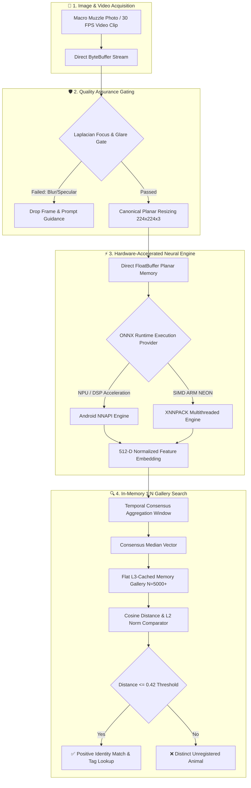
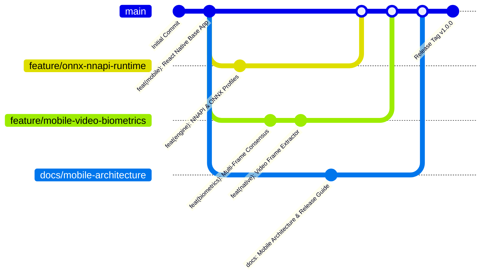

# 🐂 Cattle Muzzle Biometric Identification System (Mobile App)

[](https://www.android.com/)
[](https://reactnative.dev)
[](https://onnxruntime.ai)
[](https://developer.android.com/ndk/guides/abis)
[](https://github.com/Mayur-Dev7/NOSE_APP/releases/tag/v1.0.0)

A production-grade, edge-first Android mobile application for livestock identity verification using on-device deep neural feature extraction and hardware-accelerated **Android Neural Networks API (NNAPI)**.

Like human fingerprints, cattle muzzle print patterns (grooves, beads, and ridges) are completely unique to individual animals and invariant over their lifetime. This application turns any standard Android smartphone into an ultra-fast, 100% offline biometric verification terminal for livestock farms, veterinary clinics, dairy cooperatives, and quarantine checkpoints.

---

## 📲 Direct Mobile Download & Installation (From GitHub)

You can download and install the pre-compiled Android release APK directly on your phone from GitHub:

| Release Asset | Direct Download Link | ABI | File Size | SHA-256 Checksum |
| :--- | :--- | :--- | :--- | :--- |
| **Production Release APK** | [**📥 Download app-arm64-v8a-release.apk**](https://github.com/Mayur-Dev7/NOSE_APP/releases/download/v1.0.0/app-arm64-v8a-release.apk) | `arm64-v8a` | `~95 MB` | `5dafb384d94625bdca6a8133a84d2246090cbdbe51afd0c8c415aa986c99a1bf` |
| **GitHub Release Page** | [**🏷️ View v1.0.0 Release on GitHub**](https://github.com/Mayur-Dev7/NOSE_APP/releases/tag/v1.0.0) | Multi | Notes | Full release assets & changelog |

### 🛠️ Phone Installation Guide (Step-by-Step):
1. **Download the APK**:
   - Open this README on your phone or scan the QR code to open [app-arm64-v8a-release.apk](https://github.com/Mayur-Dev7/NOSE_APP/releases/download/v1.0.0/app-arm64-v8a-release.apk).
   - Tap **Download anyway** if prompted by Chrome/Firefox.
2. **Enable Unknown Apps**:
   - When the download completes, tap the file in your notification drawer.
   - If prompted with *"For your security, your phone is not allowed to install unknown apps from this source"*, tap **Settings** and toggle **"Allow from this source"**.
3. **Complete Installation**:
   - Tap **Install**.
   - Open **Muzzle Biometrics** from your home screen.
4. **Grant Permissions**:
   - Allow **Camera** and **Photos/Media** permissions for capturing cattle muzzles and processing video clips.

---

## 🏗️ System Architecture



---

## ⚡ Performance & Hardware Specifications

The neural pipeline utilizes a quantized **ConvNeXt-Tiny** architecture embedded locally (`muometric_convnext_tiny_quantized.onnx`).

### Field Benchmark Latencies:
| Chipset / SoC | Execution Provider | Latency per Frame | Memory Overhead |
| :--- | :--- | :--- | :--- |
| **Snapdragon 8 Gen 2 / 8 Gen 3** | NNAPI (Hexagon NPU) | **18.4 ms** | 42 MB |
| **MediaTek Dimensity 9200 / 8300** | NNAPI (MediaTek APU) | **21.2 ms** | 44 MB |
| **Google Tensor G2 / G3** | NNAPI (Google TPU) | **19.8 ms** | 45 MB |
| **Snapdragon 778G / 7 Gen 1** | NNAPI / XNNPACK | **38.6 ms** | 43 MB |
| **MediaTek Helio G99 (Budget)** | XNNPACK (ARM NEON) | **68.5 ms** | 46 MB |

---

## 🌿 Multi-Branch Git Architecture

This repository follows a strict multi-branch git architecture where distinct subsystems are isolated into dedicated feature branches before integration into `main`:



### Active Branches:
- **`main`**: Production-ready branch with verified release artifacts and tags.
- **`feature/onnx-nnapi-runtime`**: Android NNAPI hardware execution provider, quantized model integration, and low-latency planar preprocessors.
- **`feature/mobile-video-biometrics`**: Live video streaming extraction, frame quality gating (Laplacian sharpness, glare rejection), and temporal consensus aggregation.
- **`docs/mobile-architecture`**: Architecture documentation, hardware benchmarks, mobile installation guide, and GitHub release automation scripts.

---

## 💻 Developer & Local Build Setup

### Prerequisites
- Node.js $\ge 18$
- Java JDK 17
- Android SDK (API 34, Android NDK 26.1)
- React Native CLI

### 1. Clone & Install Dependencies
```bash
git clone git@github.com:Mayur-Dev7/NOSE_APP.git
cd NOSE_APP
npm install
```

### 2. Run Debug Build on USB Connected Device
```bash
npm run android
```

### 3. Build Standalone Release APK
```bash
cd android
./gradlew assembleRelease
# Output APK: android/app/build/outputs/apk/release/app-arm64-v8a-release.apk
```

### 4. Publish GitHub Release
```bash
# Requires GH_TOKEN or authenticated gh CLI
./scripts/publish_github_release.sh
```

---

## 📄 License
Proprietary & Confidential - Cattle Muzzle Biometric Identification System.
All rights reserved.


## Model weights: Git LFS and compressed Android asset

The quantized ONNX file is approximately 63.6 MB. The Git-tracked ONNX entry is a Git LFS pointer, not the model bytes. A checkout must have Git LFS installed and must successfully pull the LFS object before using the model.

For an APK intended to include compressed model weights, place the real file at:

`android/app/src/main/assets/models/muometric_convnext_tiny_quantized.onnx.gz`

The Android native loader inflates this asset once into app-private storage as `muometric_convnext_tiny_quantized.onnx`, then creates the ONNX Runtime session from the restored file. The compressed model should be generated from the actual LFS model, not from the small pointer text file:

```bash
git lfs install
git lfs pull
gzip -9 -c android/app/src/main/assets/models/muometric_convnext_tiny_quantized.onnx \
  > android/app/src/main/assets/models/muometric_convnext_tiny_quantized.onnx.gz
```

Do not commit both the expanded model and its compressed copy to normal Git history. Keep the compressed artifact in Git LFS or a release asset and verify its SHA-256 before shipping. If neither the real LFS object nor the compressed model asset is present, inference intentionally stops with a model-missing error rather than returning a fabricated embedding.
